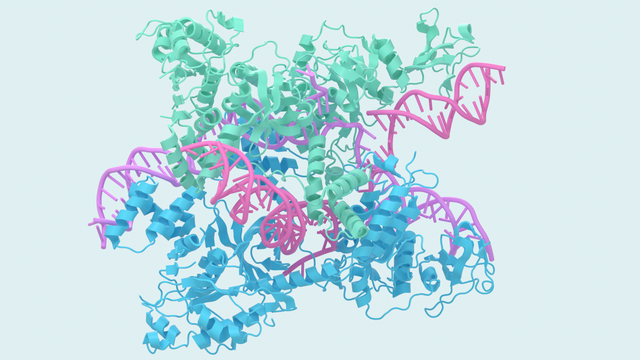
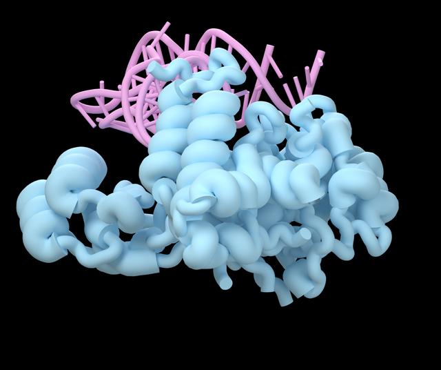
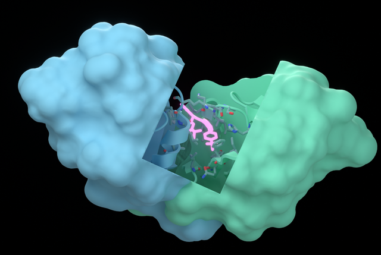
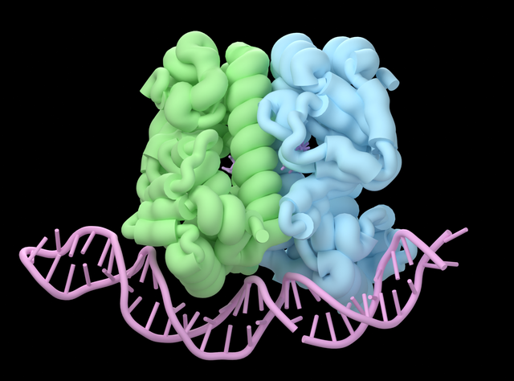
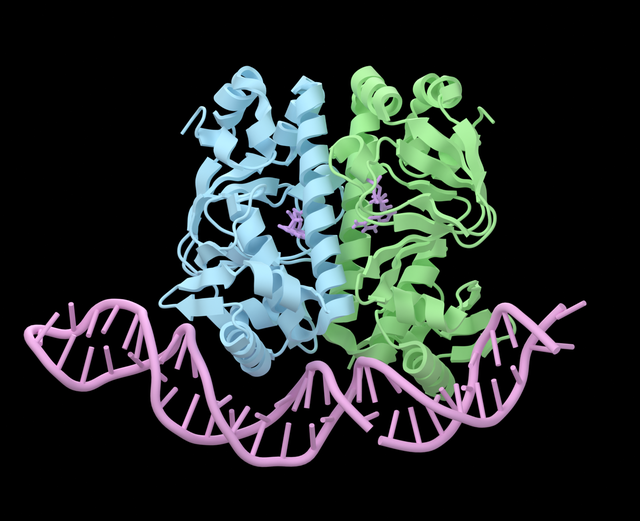
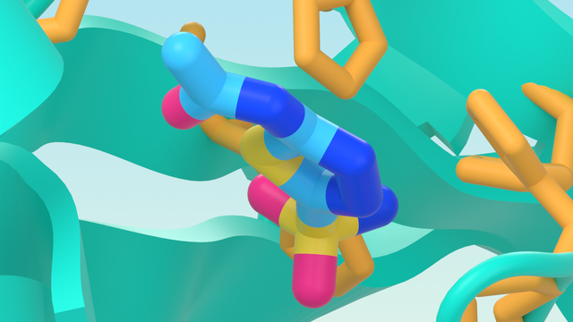
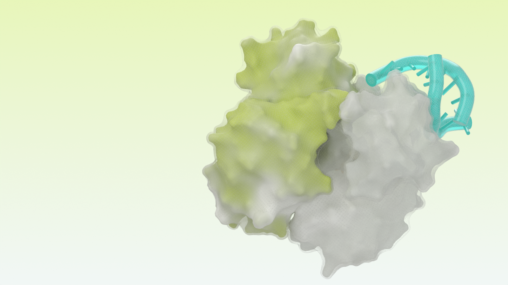
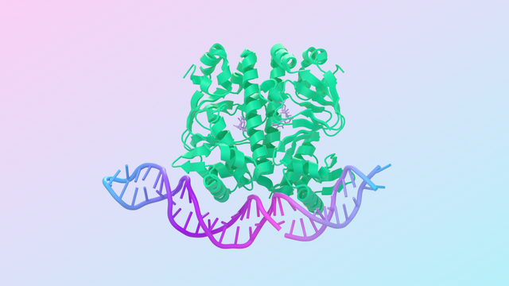
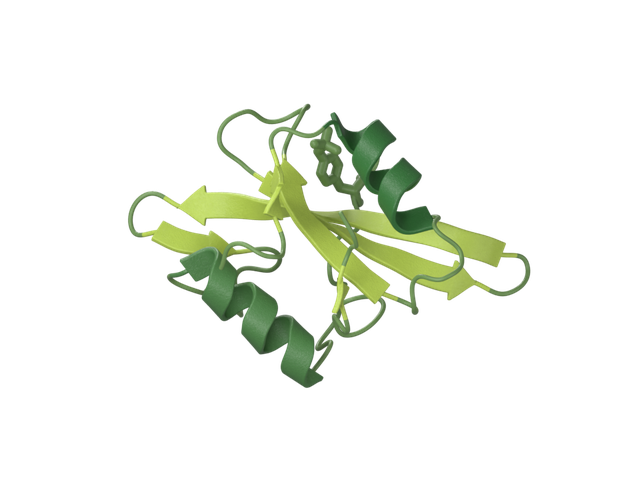

# Blender Render

If you're tired of seeing AI slop proteins on social media, with branching chains
and loopy salad wrapped around them, start with an actual structure and give it a
look you like.

Blender Render turns your protein, DNA or RNA structure into polished images and
animations using Blender and Molecular Nodes. The molecular geometry comes from
your structure file, while you choose the colors, materials, lighting and camera.
You can make an attractive figure without relying on an AI image generator to
invent what a protein looks like.

Start with one of the 14 [built-in presets](#preset-gallery), from soft pastel
ribbons to frosted surfaces and vivid binding-site views. If you have a PNG with a
style you love, the [recreate-render-preset skill](#claude-code-and-codex) can use it
as a visual reference, refine the look through local previews and save a reusable
preset for your structures.

Work from PyMOL or the command line, or ask Claude Code or Codex to run the same
local tools for you. Export a transparent PNG for a slide or paper, save an editable
Blender scene, or use Structure Studio's six animation recipes to rotate your
structure, reveal a binding site or play through supplied molecular states.

Optional local MCP tools connect compatible assistants to the renderer. An opt-in
[completed-image delivery adapter](docs/hosted-adapter.md) can be embedded in an
authenticated host; this repository does not deploy a hosted rendering service.

The previous `main` is preserved on
[`codex/backup-main-before-minimal-2026-09-29`](https://github.com/magnusbauer/blender_render/tree/codex/backup-main-before-minimal-2026-09-29).

## Install and configure

Use Python 3.11 (matching Blender's Python ABI):

```sh
uv sync --locked --extra dev --extra mcp
source .venv/bin/activate
```

Omit `mcp` if you only need the CLI/PyMOL bridge. Rendering requires the versions in
`blender_render/runtime.lock.json`: Blender 5.0.1, Molecular Nodes 4.5.10, NumPy
1.26.4 and Biotite 1.6.0, plus the pinned CCD database. PyMOL file import uses a
separate interpreter with `pymol2`; an existing PyMOL environment is suitable.
For isolated Studio environments and a Linux rebuild from the same pins, see
[runtime setup](docs/runtime-environments.md). Installations are explicit and
never triggered by viewing a structure.

To install the pinned Blender runtime into user-owned storage on Apple Silicon
macOS or Linux x86_64 (downloads Blender and Python dependencies):

```sh
blender-render setup --install-runtime --pymol-python /path/to/pymol/python
```

To keep Blender, its dependencies and configuration inside this checkout, set the
configuration root before running setup:

```sh
export BLENDER_RENDER_HOME="$PWD/.runtime"
blender-render setup --install-runtime --pymol-python /path/to/pymol/python
```

That installs Blender at `.runtime/runtime/Blender.app` on Apple Silicon macOS.
Keep `BLENDER_RENDER_HOME` set when rendering or starting MCP so the same local
configuration is used. `.runtime/` is excluded from Git. The fresh Mac runtime
installation and an actual render have been [verified](docs/validation.md#fresh-mac-installation).

Or configure an existing runtime without installing anything:

```sh
blender-render setup \
  --blender /path/to/blender \
  --pymol-python /path/to/pymol/python \
  --runtime-path /path/to/python3.11/site-packages \
  --runtime-path /path/to/extensions/blender_org \
  --ccd /path/to/biotite/structure/info/components.bcif
blender-render doctor
```

Each `--runtime-path` must be an existing directory supplying the pinned rendering
dependencies. If using a Molecular Nodes extension with bundled wheels, add
`--runtime-wheels /path/to/molecularnodes/wheels`; these are extracted into each
isolated render environment. The dependency directories must include `jsonschema`.
`setup` saves configuration; `doctor` is read-only. A successful render verifies
source hashes, runtime versions and the CCD digest before reporting completion.
Configuration lives in `~/.config/blender-render/config.json`; set
`BLENDER_RENDER_HOME` to use a separate configuration directory.

## Render locally

```sh
blender-render presets
blender-render render examples/1sps.cif --rough -o renders/example.png
blender-render render structure.pse --preset dried_paint_green --save-blend -o renders/paint.png
blender-render render structure.pse --style-json my-style.json -o renders/custom.png
blender-render export structure.pse -o bundle.json
```

Inputs are trusted local `.pse`, `.cif`, `.mmcif`, `.pdb` or exported bundle `.json`
files. PSE loading can execute code; use sessions you trust. CIF/PDB imports get a
PyMOL-generated view. Sessions and bundles preserve their saved pose by default;
explicit camera fields in a style take precedence. `--no-preserve-view` opts into
the preset's camera. Rough mode changes only performance settings.

Each render writes the requested PNG plus a sibling `NAME.render/` directory with
`manifest.json`, `resolved-style.json`, source/runtime provenance and logs. Optional
Blender scenes are saved there as `render.blend`. Output names must be new. Failed
runs retain their logs; choose a new name after fixing the problem. Temporary source
snapshots are removed unless `--keep-temp` is requested.

## Preset gallery

Choose one of the featured presets below with `--preset ID` in the CLI or
`preset=ID` in PyMOL. `mint_sky_assembly` is the default. Click a preset name
for its complete editable JSON or a preview for the full image.

These are the retained public-structure gallery renders. A preset controls style;
your structure and saved PyMOL pose determine its composition. Some presets use
specific chain or ligand selections, which may need adapting for another structure.
See [preset details](docs/reference-presets.md) and the
[gallery provenance](examples/presets/gallery.json) for the examples and settings.

| Preset | Appearance | Preview |
| --- | --- | --- |
| [mint_sky_assembly](blender_render/style_preset_mint_sky_assembly.json) | **Default.** Mint and sky protein assembly with purple and pink nucleic acids. | [](examples/presets/mint_sky_assembly.png) |
| [powder_blue_rounded](blender_render/style_preset_powder_blue_rounded.json) | Powder blue rounded protein with pink nucleic acid on black. | [](examples/presets/powder_blue_rounded.png) |
| [cyan_mint_cutaway](blender_render/style_preset_cyan_mint_cutaway.json) | Cyan and mint surfaces with clean pocket cuts and intact interior ribbons. | [](examples/presets/cyan_mint_cutaway.png) |
| [pastel_duplex_rounded](blender_render/style_preset_pastel_duplex_rounded.json) | Rounded green and blue proteins with pink DNA on black. | [](examples/presets/pastel_duplex_rounded.png) |
| [pastel_duplex_cartoon](blender_render/style_preset_pastel_duplex_cartoon.json) | Thin blue and green secondary-structure ribbons with pink DNA. | [](examples/presets/pastel_duplex_cartoon.png) |
| [vivid_binding_site](blender_render/style_preset_vivid_binding_site.json) | Macro ligand view with vivid element colors and teal cartoon context. | [](examples/presets/vivid_binding_site.png) |
| [ivory_lime_frosted](blender_render/style_preset_ivory_lime_frosted.json) | Ivory frosted grid shell, lime core and cyan nucleic acids. | [](examples/presets/ivory_lime_frosted.png) |
| [neon_duplex_hero](blender_render/style_preset_neon_duplex_hero.json) | Green protein and gradient nucleic acids against a pink-cyan background. | [](examples/presets/neon_duplex_hero.png) |
| [dried_paint_green](blender_render/style_preset_dried_paint_green.json) | Textured matte green paint with rounded ribbon edges. | [](examples/presets/dried_paint_green.png) |

```sh
blender-render render structure.pse --preset pastel_duplex_rounded -o renders/duplex.png
```

All presets also support `--animation rock` and `--animation 360`. Use
`blender-render presets` to include your own saved presets in the catalog.

## Rocking and 360° GIFs

Install FFmpeg with the `libx264` and GIF encoders on your PATH. On macOS:

```sh
brew install ffmpeg
```

Then render with any built-in or saved preset:

```sh
blender-render render examples/1sps_pose.pse --animation rock --rock-angle 12 \
  --duration 3 --fps 24 --gif --width 640 --height 480 -o renders/rock.png
blender-render render examples/1sps_pose.pse --animation 360 \
  --duration 6 --fps 24 --gif --width 640 --height 480 -o renders/spin.png
```

Each animation writes PNG, MP4 and lossless `.frames.zip` files beside the requested
PNG; `--gif` adds a looping GIF. `rock_angle=12` means ±12° (24° total swing).
The camera orbits around the structure using its initial up axis; the initial pose
is retained as the PNG and restored in an optional saved Blender scene. Movies
composite transparent pixels onto white; saved PNG frames retain alpha.

Re-encode saved frames without launching Blender:

```sh
blender-render movie-export renders/rock.frames.zip -o renders/rock-again.gif
```

See [animation controls and limits](docs/animation.md), including PyMOL playback
and MCP usage. Animation takes one render per frame, so start with small dimensions
and low samples and increase `--timeout` for longer runs.

## PyMOL bridge

Run `blender-render setup` from the installed environment first; this records the
Python used to run renders. In PyMOL, load the plugin using its absolute checkout path:

```pymol
run /absolute/path/to/blender_render/blender_render/pymol_bridge_plugin.py
blender_render
blender_render selection=(all), preset=dried_paint_green, output_dir=renders, output_name=paint.png
blender_render style_json=/absolute/path/to/my-style.json, output_name=custom.png
```

The adapter exports enabled objects, transforms, colors, secondary structure and
camera, calls local Blender through the configured Python, then loads the PNG into
PyMOL. Rendering is synchronous. `width`, `height`, `samples`, `rough`, `save_blend`,
`color_follow`, `preserve_view`, `blender_exe` and `timeout` are optional arguments.
For animations, add `animation=rock` or `animation=360`, `gif=1`, `duration`, `fps`
and (for rocking) `rock_angle`. Optional movie preview needs Pillow installed in
PyMOL's Python; for the repo-local Pixi environment:

```sh
pixi add --manifest-path .runtime/pymol/pixi.toml pillow
```

```pymol
blender_render animation=rock, gif=1, width=640, height=480, output_name=rock.png
blender_movie_export filename=rock-again.gif
```

Movie preview replaces PyMOL's current movie timeline when supported; `auto_preview=0`
keeps the timeline untouched. Headless/unsupported GUI contexts return saved movie
paths. `blender_movie_export` uses the latest verified frames or an explicit
`source=/path/to/rock.frames.zip`; FFmpeg must be on PyMOL's PATH.
Former service/profile/remote arguments are intentionally unsupported.

## Claude Code and Codex

Open this checkout in either agent and use the CLI above. The repository includes
`recreate-render-preset` in `.agents/skills/` and a linked entry in `.claude/skills/`.
Example request:

> Use recreate-render-preset to match reference.png on structure.pse. Save the full
> style JSON, compare local previews, and register it as user/my-reference.

The skill inspects the actual image, records observable features, generates a
validated starting JSON, refines it through local renders, then saves and reloads
the preset. It explicitly reports remaining mismatches. See the
[skill](.agents/skills/recreate-render-preset/SKILL.md).

Optional MCP configuration, using the absolute path to this environment:

```sh
codex mcp add blender-local -- /absolute/path/to/blender_render/.venv/bin/blender-render mcp
claude mcp add --transport stdio blender-local -- /absolute/path/to/blender_render/.venv/bin/blender-render mcp
```

The four tools are `presets`, `inspect_style`, `render_structure` and `read_render`.
`render_structure` accepts `animation`, `duration`, `fps`, `rock_angle`, `gif`,
`width`, `height`, `samples` and `timeout`. Rendering returns local artifact paths;
`read_render` returns the PNG as MCP image
content for inspection. Configure a client tool timeout appropriate for a render
(up to the default 600 seconds). The MCP process uses the same user's local config
and never opens an HTTP listener. Client registration is optional and is not done
by installing this package. These commands follow the official
[Codex MCP](https://developers.openai.com/codex/mcp/) and
[Claude Code MCP](https://code.claude.com/docs/en/mcp) documentation; repository skill
locations follow [Codex skills](https://developers.openai.com/codex/skills/) and
[Claude Code skills](https://code.claude.com/docs/en/skills).

## Preset authoring

```sh
blender-render dev catalog
blender-render dev inspect pastel
blender-render dev schema
blender-render dev reference reference.png --observations observations.json \
  --style-output candidate.json > decision.json
blender-render dev validate candidate.json
blender-render dev save user/my-reference candidate.json \
  --description 'My reference style' --provenance decision.json
blender-render render structure.pse --preset user/my-reference -o renders/saved.png
```

`dev reference` records agent-supplied observations; it is not an automatic image
recognizer. `--style-output` emits a complete style document and refuses to overwrite
an existing file. A saved catalog preset is a metadata envelope; use its ID with
`--preset`, or extract its `style` for `--style-json`. Save defaults to
`--camera-policy preserve_input`; choose `authored` deliberately for a reusable
camera composition. `dev preview --help` exposes explicit runtime paths and source
snapshots for renderer development. Built-ins cannot be overwritten.

## Development and license

```sh
python -m pytest
python -m build --wheel
```

See [validation](docs/validation.md) for executed checks and limits. Public example
structures and citations are in `examples/structures.json`. The client code is MIT;
Blender API scripts and Molecular Nodes assets retain their GPL terms. See
[THIRD_PARTY_NOTICES.md](THIRD_PARTY_NOTICES.md).
