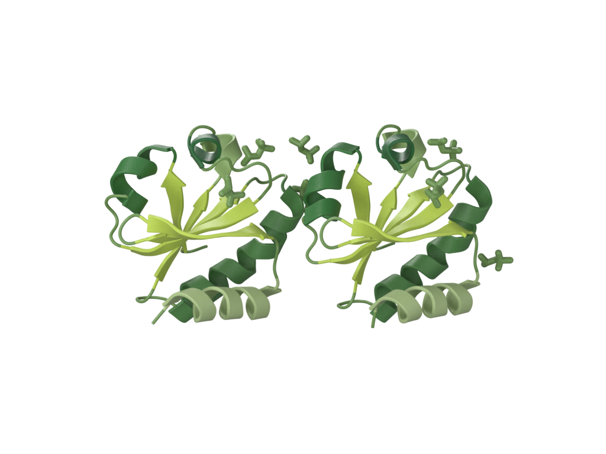

# Blender Render

Ray-traced molecular stills from PyMOL, with the saved pose, colors, and transparent background. Use the same Blender renderer on an Apple Silicon Mac, your lab's SLURM cluster, or Modal, and connect it to Codex or ChatGPT through MCP.

This is the **private 0.2.0b1 beta**. The repository and release artifacts remain private, and the hosted endpoint admits only the owner's GitHub account. Public publication, publisher identity verification, and OpenAI portal submission are deferred at the owner's request. The [validation report](docs/release-validation.md) distinguishes executed checks from remaining release gates.



The renderer pins **Blender 5.0.1**, **Molecular Nodes 4.5.10**, and **Python 3.11**. Preset 1 remains the default pastel style. `dried_paint_green` adds pigment variation, surface relief, and rounded ribbon edges. Output is a PNG plus a provenance manifest, with an optional `.blend` download. Animation and interactive 3D editing are outside this beta.

## Choose compute

| Compute | Setup | Use |
|---|---|---|
| Mac | Install the wheel and run setup | `blender_render` inside PyMOL; Metal with CPU fallback |
| Own HPC | Add a named cluster profile | `blender_render mode=interactive, profile=ipd`; warm Apptainer worker with SSH transport |
| Shared Modal | Install the plugin and sign in with GitHub | Import, submit, inspect progress, preview, and download |
| Your Modal account | Deploy a personal service with an explicit budget | Connect its HTTPS MCP URL |

- [Mac installation and PyMOL](docs/mac.md)
- [SLURM, Apptainer, and a lab HTTPS gateway](docs/hpc.md)
- [Codex and ChatGPT plugin installation](docs/plugin.md)
- [Modal deployment and budget operation](docs/modal.md)
- [Troubleshooting](docs/troubleshooting.md)

## Quick start

After installing the release wheel's `server` extra in Python 3.11:

```sh
blender-render setup --install-runtime
```

Run the plugin path printed by setup in PyMOL, then:

```python
blender_render
blender_render preset=dried_paint_green, transparent_background=1, save_blend=1
```

For files on disk, configure `--pymol-python` with an interpreter containing `pymol2`, then:

```sh
blender-render render pose.pse --preset dried_paint_green --transparent --save-blend -o figure.png
```

PSE input preserves enabled objects, object transforms, the saved camera/projection/FOV, and PyMOL colors. CIF and PDB input receive a fitted initial view. Export is CIF-first and assigns secondary structure before rendering. Ligands use native Molecular Nodes sticks, with no legacy ball-and-stick fallback. Rough mode changes performance settings only.

## Jobs and provenance

The versioned API provides upload, immediate asynchronous submission, status, cancellation, results, and expiring downloads. Submission is idempotent; reconnect to the returned job ID instead of launching another render after a network interruption. One durable FIFO queue owns each service's Blender worker. Local and HPC services stop after 15 idle minutes.

Each manifest records input hashes and provenance, DSS status, structure format, selected geometry backends, resolved preset, runtime and GPU versions, camera settings, timings, and output checksums. Temporary run directories are cleaned by default.

The shared service allows ten completed renders per UTC day, reserving a daily slot for each pending job. Upload counts and daily GPU minutes have no quota. The owner's verified GitHub account is exempt from the daily limit during testing. Output defaults to 2048 pixels, with a 4096-pixel maximum dimension and a ten-minute job timeout. Worst-case costs are reserved before dispatch, including for the testing account; the lifetime budget still applies. Inputs are deleted after rendering, and unused uploads expire after five minutes. Results are deleted after download or fifteen minutes after completion. There is no retained structure library or public gallery. See [privacy](docs/privacy.md) and [terms](docs/terms.md).

## Development

```sh
python3.11 -m venv .venv
.venv/bin/python -m pip install -e '.[dev,server,mcp,modal]'
.venv/bin/python -m pytest
.venv/bin/python -m build
```

`blender_render` is the only implementation package. `bridge_runner`, `render_server`, and the PyMOL script remain compatibility entry points. The preset JSON schema and packaged runtime lock are shared by all backends. See [architecture](docs/architecture.md) and [release validation](docs/release-validation.md).

The examples use public PDB structures; accession, source URL, and SHA256 are recorded in `examples/structures.json`.

## License and support

Independently authored bridge/client code is MIT. Blender, Molecular Nodes, and other dependencies retain their licenses and source availability; the combined runtime is not MIT-only. [Dependency notices](THIRD_PARTY_NOTICES.md) describe the distributed source bundle and upstream licenses.

Report reproducible problems through [GitHub issues](https://github.com/magnusbauer/blender_render/issues), preferably with a public example and a reviewed manifest. OpenAI directory publication is deferred; private testing uses repository installation and the restricted MCP endpoint.
